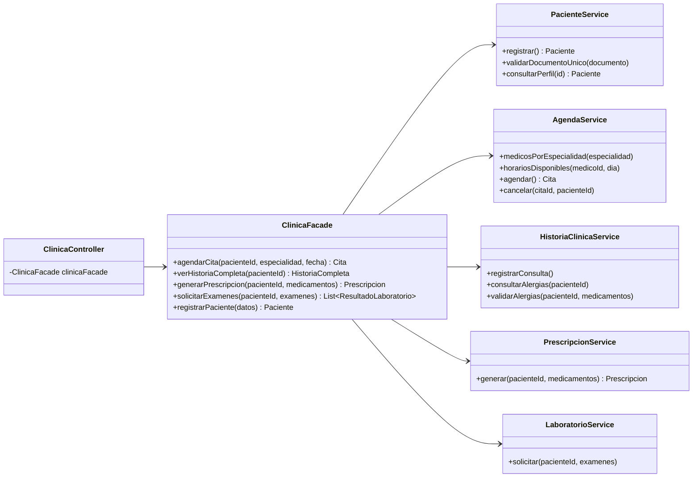

# Sistema de Gestión Médica — Taller Patrón Facade

Portal para pacientes de una clínica: agendar citas, ver la historia clínica, recibir prescripciones y solicitar exámenes de laboratorio. Toda la lógica interna queda oculta detrás de una **fachada** (`ClinicaFacade`).

**Materia:** Patrones de Software — Universidad Cooperativa de Colombia, sede Pasto
**Docente:** Jhonatan Andrés Mideros Narváez

| Integrante | Parte |
| --- | --- |
| Juan David Moreno | Backend: base del proyecto, `PacienteService`, `AgendaService`, `ClinicaFacade`, controlador REST, despliegue en Railway |
| David Campiño | Backend: `HistoriaClinicaService`, `PrescripcionService`, `LaboratorioService` y sus pruebas |
| Andres Delgado | Frontend en React: login, dashboard, agendar cita, historia clínica, laboratorio, despliegue en Vercel |

## URLs en producción

- Frontend (Vercel): https://taller-facade.vercel.app
- Backend (Railway): https://taller-facade-production.up.railway.app

Usuario de prueba: documento **1085000000**, contraseña **demo123**.

## Patrón Facade aplicado

El controlador REST (el cliente) solo conoce a `ClinicaFacade`. La fachada coordina los 5 subsistemas, que no se conocen entre sí.



Cada método de la fachada invoca mínimo 2 subsistemas:

| Método de `ClinicaFacade` | Subsistemas que usa |
| --- | --- |
| `agendarCita(pacienteId, especialidad, fecha)` | Paciente (valida que exista) + Agenda (disponibilidad, cita y recordatorio) |
| `verHistoriaCompleta(pacienteId)` | Los 5: paciente, citas, consultas y alergias, prescripciones y laboratorios en **un solo objeto** |
| `generarPrescripcion(pacienteId, medicamentos[])` | Paciente + Historia clínica (**valida alergias**) + Prescripción |
| `solicitarExamenes(pacienteId, examenes[])` | Paciente + Laboratorio (resultados simulados con valores de referencia) |
| `registrarPaciente(datos)` | Paciente (documento único) + Historia clínica (abre la historia con las alergias) |

## Endpoints

Datos completamente en memoria (se reinician cuando se reinicia el servidor).

| Método | Ruta | Qué hace |
| --- | --- | --- |
| POST | `/api/clinica/paciente` | Registra un paciente |
| POST | `/api/clinica/cita` | Agenda una cita (`medicoId` opcional) |
| GET | `/api/clinica/historia/{pacienteId}` | Historia completa consolidada |
| POST | `/api/clinica/prescripcion` | Genera prescripción validando alergias |
| POST | `/api/clinica/laboratorio` | Solicita exámenes y devuelve resultados |
| GET | `/api/clinica/medicos?especialidad=&fecha=` | Médicos de la especialidad con horarios libres |
| POST | `/api/clinica/login` | Inicio de sesión (apoyo al frontend) |
| DELETE | `/api/clinica/cita/{citaId}?pacienteId=` | Cancela una cita |
| GET | `/api/clinica/especialidades` | 3 especialidades |
| GET | `/api/clinica/laboratorio/examenes` | Hemograma, glicemia, perfil lipídico |

Ejemplos de cuerpo:

```json
POST /api/clinica/cita
{ "pacienteId": 1, "especialidad": "Cardiología", "fecha": "2026-10-20T09:00", "medicoId": 3 }

POST /api/clinica/prescripcion
{ "pacienteId": 1, "medicamentos": [ { "nombre": "Loratadina 10 mg", "dosis": "1 diaria", "duracion": "5 días" } ] }

POST /api/clinica/laboratorio
{ "pacienteId": 1, "examenes": ["HEMOGRAMA", "GLICEMIA", "PERFIL_LIPIDICO"] }
```

Datos predefinidos: 3 especialidades (Medicina General, Cardiología, Dermatología) y 5 médicos. Horario de citas de lunes a sábado: 8:00, 9:00, 10:00, 11:00, 14:00, 15:00 y 16:00.

## Correr en local

```bash
# Backend (Java 21 + Maven)
cd backend
mvn spring-boot:run          # http://localhost:8080

# Frontend (Node 18+)
cd frontend
npm install
npm run dev                  # http://localhost:5173
```

## Despliegue

**Backend en Railway**
1. New Project → Deploy from GitHub repo → elegir este repositorio.
2. En el servicio: **Settings → Root Directory** = `backend`. Railway detecta el `Dockerfile`.
3. **Settings → Networking → Generate Domain**. Probar `https://<dominio>/` y `https://<dominio>/api/clinica/especialidades`.
4. Cuando el frontend esté arriba, agregar la variable `FRONTEND_URL` con la URL de Vercel (sin `/` al final).

**Frontend en Vercel**
1. Add New → Project → importar este repositorio.
2. **Root Directory** = `frontend` (Vercel detecta Vite).
3. **Environment Variables:** `VITE_API_URL` = URL del backend en Railway (sin `/` al final).
4. Deploy.
